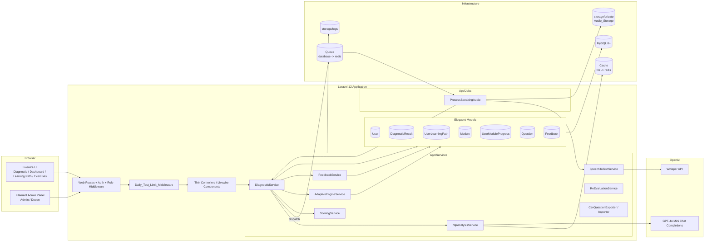
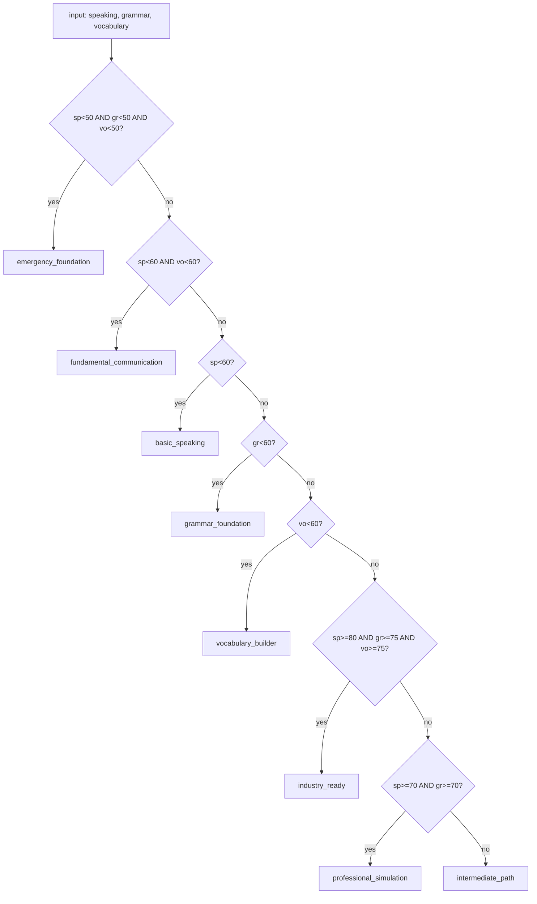
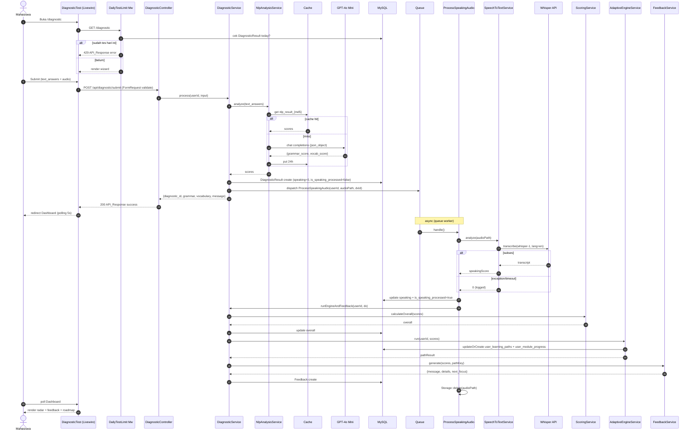
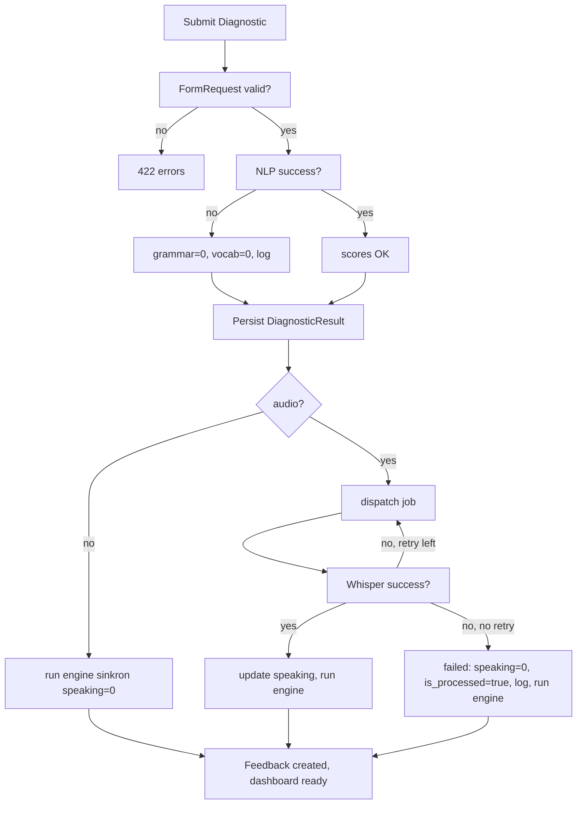

# Design Document — APELS Platform

## Overview

APELS (Adaptive Professional English Learning System) adalah aplikasi web Laravel 12 + Livewire 3 yang mengukur kemampuan Bahasa Inggris mahasiswa pada tiga skill (Speaking, Grammar, Vocabulary) dan menentukan satu dari delapan learning path secara otomatis menggunakan rule-based Adaptive Engine. Dokumen ini menjabarkan arsitektur, skema data, kontrak API, struktur folder, service layer, jobs, middleware, Filament resources, integrasi OpenAI Whisper + GPT-4o Mini, properti korektnis, error handling, dan strategi testing untuk implementasi MVP yang menargetkan rilis awal Juli 2025.

### Tujuan Design

- Menjadikan AdaptiveEngineService sebagai inti yang **deterministik, total, dan idempoten** sehingga keputusan path dapat diaudit dan direproduksi.
- Memisahkan business logic ke `App\Services` agar UI (Livewire/Filament) hanya sebagai presenter dan controller hanya sebagai thin orchestrator.
- Mengontrol biaya OpenAI ≤ USD 20/bulan melalui middleware 1 tes/hari, NLP cache 24 jam, queue async untuk Whisper, dan penghapusan file audio.
- Menyediakan jalur upgrade antara environment dev (queue/cache file/database) dan production (Redis + Supervisor) tanpa mengubah kontrak service.

### Pemetaan Phase Implementasi (Req 33)

| Phase | Cakupan | Komponen Design |
|-------|---------|-----------------|
| Phase 1 — MVP Core | Auth 3 role, Daily_Test_Limit_Middleware, DiagnosticTest wizard, Whisper, GPT-4o Mini, Scoring, Adaptive Engine, Feedback, Dashboard | §3 Architecture, §4 Components (Diagnostic, Auth, Engine, Feedback), §5 Data Models, §7 Integration Design |
| Phase 2 — Learning System | Learning roadmap, Module detail (Financial Presentation + Client Meeting), Exercise per modul, Progress tracking, Re-evaluation 70% | §4 Components (Learning, Exercise, ReEvaluation), §5 Data Models (`user_module_progress`, `questions`) |
| Phase 3 — Admin & Laporan | Filament UserResource, QuestionResource (+ CSV import/export), ModuleResource, DiagnosticResultResource | §4 Components (Filament Resources), §6 API & Routing, §7 CSV Round-Trip |
| Phase 4 — Polish & Testing | Unit test 8 path, feature test endpoint, performance test 100+ user, security review, deploy VPS | §8 Correctness Properties, §10 Testing Strategy, §9 Error Handling |

> AdaptiveEngineService **harus** stabil sebelum Phase 2 dimulai (Req 33.6).

---

## Architecture

### High-Level Architecture



### Lapisan Arsitektur

1. **Presentation Layer** — Livewire 3 components (`App\Livewire\Student\*`, `App\Livewire\Lecturer\*`) dan Filament 3 resources (`App\Filament\Resources\*`). Tidak boleh berisi business logic; hanya orchestrate Service dan render Blade/Filament view.
2. **HTTP Layer** — Routes (`routes/web.php`, `routes/api.php`), `EnsureDailyTestLimit` middleware, FormRequest (`SubmitDiagnosticRequest`), policies via Spatie Permission.
3. **Service Layer** — Business logic murni di `App\Services`. Setiap service deklaratif dengan return type, mengembalikan struktur yang predictable, dan menangkap exception → log + fallback.
4. **Job Layer** — `App\Jobs\ProcessSpeakingAudio` untuk pekerjaan async (Whisper + post-processing).
5. **Persistence Layer** — Eloquent models di `App\Models` di atas MySQL 8. Tidak ada query mentah di Controller/Livewire.
6. **Infrastructure Layer** — Cache (NLP_Cache 24 jam), Queue (database dev → Redis prod), Storage privat (`storage/private`), Log (`storage/logs/laravel.log`).
7. **External** — OpenAI Whisper (`whisper-1`) dan GPT-4o Mini (`gpt-4o-mini`).

### Folder Structure (Final)

```
app/
├── Http/
│   ├── Controllers/
│   │   └── Api/
│   │       └── DiagnosticController.php          # POST /api/diagnostic/submit
│   ├── Middleware/
│   │   └── EnsureDailyTestLimit.php              # Req 3
│   └── Requests/
│       └── SubmitDiagnosticRequest.php           # Req 5
├── Livewire/
│   ├── Auth/                                     # bawaan Livewire Starter Kit
│   ├── Student/
│   │   ├── DiagnosticTest.php                    # wizard 3 step (Req 4)
│   │   ├── Dashboard.php                         # radar chart + feedback (Req 13)
│   │   ├── LearningPath.php                      # roadmap modul (Req 14)
│   │   ├── ModuleDetail.php                      # halaman detail modul (Req 14.5)
│   │   └── Exercise.php                          # quiz per modul (Req 15)
│   └── Lecturer/
│       └── Reports.php                           # laporan berkala dosen (Req 22)
├── Services/
│   ├── DiagnosticService.php                     # orkestrasi (Req 4, 6, 7, 12)
│   ├── ScoringService.php                        # weighted overall (Req 8)
│   ├── AdaptiveEngineService.php                 # CORE rule engine (Req 9, 10, 11, 26)
│   ├── FeedbackService.php                       # template selection (Req 12)
│   ├── SpeechToTextService.php                   # OpenAI Whisper wrapper (Req 6, 23, 27)
│   ├── NlpAnalysisService.php                    # OpenAI GPT-4o Mini wrapper (Req 7, 27)
│   ├── ReEvaluationService.php                   # 70% trigger (Req 16)
│   └── Csv/
│       ├── CsvQuestionExporter.php               # pretty-printer (Req 20.5, 34.4)
│       └── CsvQuestionImporter.php               # parser (Req 20.2-20.4)
├── Jobs/
│   └── ProcessSpeakingAudio.php                  # queue job (Req 6, 31)
├── Models/
│   ├── User.php
│   ├── DiagnosticResult.php
│   ├── UserLearningPath.php
│   ├── Module.php
│   ├── UserModuleProgress.php
│   ├── Question.php
│   └── Feedback.php
├── Filament/
│   └── Resources/
│       ├── UserResource.php                      # admin only (Req 18)
│       ├── QuestionResource.php                  # admin + dosen (Req 19, 20)
│       ├── ModuleResource.php                    # admin + dosen (Req 21)
│       └── DiagnosticResultResource.php          # admin full, dosen read-only (Req 22)
└── Providers/
    └── Filament/
        └── AdminPanelProvider.php

config/
├── apels.php                                     # daily_test_limit, audio_max_mb, timeouts
├── learning_paths.php                            # 8 path keys + label + color
└── openai.php                                    # bawaan openai-php/laravel

database/
├── migrations/
│   ├── 2025_xx_xx_add_columns_to_users.php
│   ├── 2025_xx_xx_create_diagnostic_results.php
│   ├── 2025_xx_xx_create_user_learning_paths.php
│   ├── 2025_xx_xx_create_modules.php
│   ├── 2025_xx_xx_create_user_module_progress.php
│   ├── 2025_xx_xx_create_questions.php
│   └── 2025_xx_xx_create_feedbacks.php
└── seeders/
    ├── RoleSeeder.php                            # 3 role + permission (Req 2)
    ├── LearningPathSeeder.php
    └── ModuleSeeder.php                          # financial_presentation + client_meeting (Req 11)

routes/
├── web.php                                       # auth + role middleware
└── api.php                                       # /api/diagnostic/submit + JSON
```

### Tech Stack Reference

| Layer | Tool | Catatan |
|-------|------|---------|
| Backend | Laravel 12 | PHP 8.2–8.4 |
| Reactive UI | Livewire 3 (Starter Kit) | Component berbasis class |
| UI Components | Flux UI (bawaan Livewire Starter Kit) | Form/button/input |
| Styling | TailwindCSS | `npm run build` di production |
| JS | Alpine.js | Wrapper ringan untuk ApexCharts |
| Chart | ApexCharts | Radar chart 3 sumbu (Req 13.1) |
| Admin Panel | Filament 3 | Single panel `/admin` |
| DB | MySQL 8+ | Skema final di §5 |
| Queue | `database` (dev) / `redis` (prod) | Tabel queue via `queue:table` |
| Cache | `file` (dev) / `redis` (prod) | NLP_Cache TTL 24 jam |
| Auth | Laravel built-in + Livewire Starter Kit | `web` guard |
| AuthZ | Spatie Laravel Permission v6+ | Role: admin/dosen/mahasiswa |
| OpenAI | `openai-php/laravel` | Whisper + GPT-4o Mini |
| CSV | `league/csv` (atau Laravel built-in) | Pretty-printer round-trip (Req 20.5) |

> Catatan: untuk Excel `.xlsx` (Req 20.2), sistem menggunakan `maatwebsite/excel`. CSV path tetap menjadi sumber kebenaran untuk round-trip property; `.xlsx` di-normalisasi ke representasi CSV internal sebelum diuji round-trip.

---

## Components and Interfaces

### 1. Authentication & Authorization (Req 1, 2)

**Komponen**
- Livewire Starter Kit handle register/login/logout views.
- `RoleSeeder` membuat role `admin`, `dosen`, `mahasiswa` + permission `take diagnostic`, `view dashboard`, `view learning path`, `do exercises`, `manage questions`, `view reports`, `import questions`, `manage users`, `manage modules`, `manage all`.
- Middleware `auth`, `verified`, dan `role:*` (Spatie) dipasang per route group.
- Field `nim` (string nullable unique) ditambahkan ke tabel `users` (Req 30.1).

**Kontrak Registrasi (Req 1)**
- Form input: `name`, `email` (unique), `nim` (unique), `password`, `password_confirmation`.
- Validation rules: `name|required|string|max:255`; `email|required|email|unique:users`; `nim|required|string|unique:users`; `password|required|confirmed|min:8`.
- Error message per field saat email/nim duplikat (Req 1.2). Pesan login generik untuk credential salah (Req 1.4).

**Kontrak Authorization (Req 2)**
- Route `/dashboard`, `/learning-path`, `/exercises`, `/diagnostic` → group `auth` + `role:mahasiswa`.
- Route `/reports` → group `auth` + `role:dosen`.
- Filament panel `/admin` → mengizinkan `admin` (full) dan `dosen` (subset resource lewat policy/`canViewAny`).
- Akses tidak sah → HTTP 403 (web) atau 401 (API guest).

### 2. Daily Test Limit Middleware (Req 3)

**Class:** `App\Http\Middleware\EnsureDailyTestLimit`

```text
handle(Request $request, Closure $next) -> Response
```

Algoritma:
1. Ambil `userId = auth()->id()`.
2. Cek apakah ada `DiagnosticResult` milik `userId` dengan `whereDate('created_at', today())`. Tanggal "today" dihitung di timezone aplikasi (`config('app.timezone')`) — Req 3.3.
3. Jika ada → return JSON 429 dengan body API_Response error (status `error`, message "Anda sudah mengerjakan tes hari ini. Coba lagi besok.", code 429).
4. Jika tidak → `$next($request)`.

Middleware terdaftar sebagai alias `daily.test.limit` di `bootstrap/app.php` (Laravel 12 style) dan dipasang pada route Diagnostic Test serta endpoint API submit.

### 3. Diagnostic Test Wizard (Req 4, 5)

**Livewire:** `App\Livewire\Student\DiagnosticTest`

Tiga step terpisah berbasis property `currentStep`:
1. **Grammar** — kumpulan input teks (mis. 3–10 elemen, masing-masing 5–500 karakter).
2. **Vocabulary** — kumpulan input teks dengan aturan validasi sama.
3. **Speaking** — input audio via `<input type="file">` (atau MediaRecorder via Alpine.js) yang diupload sekali submit final.

Submit final → memanggil `App\Http\Controllers\Api\DiagnosticController@submit` (atau memanggil service langsung dari Livewire dalam mode internal). Controller menggunakan `SubmitDiagnosticRequest` untuk validasi (Req 5), kemudian `DiagnosticService::process(int $userId, array $input): array`.

**Validasi (`SubmitDiagnosticRequest`)** — Req 5.1–5.3:
```text
text_answers      => required|array|min:3|max:20
text_answers.*    => required|string|min:5|max:500
audio             => required|file|mimes:wav,mp3,webm,ogg|max:(apels.audio_max_mb * 1024)
```
Audio disimpan via `Storage::disk('local')->putFile('diagnostic-audio', ...)` ke `storage/private` (Req 5.5, 23.1) dan path absolut diteruskan ke job.

### 4. DiagnosticService (Req 4, 6, 7, 12, 27)

```text
class DiagnosticService {
    process(int $userId, array $input): array
    runEngineAndFeedback(int $userId, DiagnosticResult $diagnostic): void
    private getAttemptNumber(int $userId): int
}
```

`process()` flow:
1. Panggil `NlpAnalysisService::analyze($input['text_answers'])` secara sinkron (cache hit-able).
2. Hitung `attempt = DiagnosticResult::where('user_id', $userId)->count() + 1`.
3. `DiagnosticResult::create([...])` dengan `speaking = 0`, `overall = 0`, `is_speaking_processed = false`, `audio_path` jika ada (Req 4.2).
4. Jika `audio_path` tersedia → `ProcessSpeakingAudio::dispatch($userId, $audioPath, $diagnostic->id)` (Req 4.3, 6.1).
5. Jika tidak ada audio → langsung `runEngineAndFeedback($userId, $diagnostic->fresh())` dengan `speaking = 0` (Req 4.4).
6. Return array sesuai Req 4.5: `['diagnostic_id', 'grammar', 'vocabulary', 'message']`.
7. Jika `NlpAnalysisService` melempar exception, tangkap, log, set `grammar=0, vocab=0`, lanjutkan tanpa membatalkan record (Req 4.6, 27.2–27.3).

`runEngineAndFeedback()` flow:
1. Hitung `overall` via `ScoringService::calculateOverall($scores)`.
2. `$diagnostic->update(['overall' => $overall])`.
3. `$pathResult = AdaptiveEngineService::run($userId, $scores)`.
4. `$feedback = FeedbackService::generate($scores, $pathResult['learning_path'])`.
5. `Feedback::create([...])` (Req 12.6).

### 5. ScoringService (Req 8)

```text
class ScoringService {
    private array $weights = ['speaking' => 0.40, 'grammar' => 0.30, 'vocabulary' => 0.30];

    calculateOverall(array $scores): float
    normalize(float $score, float $min = 0.0, float $max = 1.0): int
}
```

- `calculateOverall` mengembalikan `round(speaking * 0.40 + grammar * 0.30 + vocabulary * 0.30, 2)` (Req 8.2). Skor yang absent diperlakukan 0 (Req 8.4).
- `normalize` mengembalikan `(int) round((($score - $min) / ($max - $min)) * 100)` (Req 8.5).
- Service murni, tidak menyentuh DB/IO. Cocok untuk PBT (Property: bounds 0–100, monotonicity).

### 6. AdaptiveEngineService — CORE (Req 9, 10, 11, 26)

```text
class AdaptiveEngineService {
    run(int $userId, array $scores): array
    public evaluateRules(array $scores): string                      // exposed untuk PBT (Req 34.2)
    private resolveModules(string $pathKey, array $scores): array
    private shouldUnlock(Module $module, string $pathKey, array $scores): bool
    private persist(int $userId, string $pathKey, array $modules): void
}
```

**Validasi input** — `assert($s >= 0 && $s <= 100)` untuk speaking, grammar, vocabulary; jika di luar rentang, throw `InvalidArgumentException` (Req 9.6).

**`evaluateRules(array $scores): string`** — diuji secara properti (totality + idempotence). Urutan pencocokan (Req 9.1):



Method bersifat **pure** (tidak menyentuh DB/IO) → idempoten dan deterministik (Req 9.2, 26.1).

**`resolveModules` & `shouldUnlock`** — Req 10:
- `path_key` cocok → unlock.
- `level == 'basic'` → selalu unlock (Req 10.2).
- `level == 'professional'` → unlock jika `sp >= 70 && gr >= 70 && vo >= 70` (Req 10.3, 11.3 untuk path `industry_ready`).
- Lainnya → locked.
- Hanya proses Module dengan `is_active = true` (Req 10.6).

**`persist`** — Req 26.2, 26.3:
- `UserLearningPath::updateOrCreate(['user_id' => $userId], [...])` — menjamin satu record aktif per user (perlu `unique('user_id')` constraint atau guard via `where('status','active')`).
- Loop `unlocked` & `locked` → `UserModuleProgress::updateOrCreate(['user_id' => $uid, 'module_id' => $mid], ['is_unlocked' => bool])` — unique pada (`user_id`,`module_id`).

Return shape (Req 9.5):
```json
{
  "learning_path": "professional_simulation",
  "path_label":    "Professional Simulation",
  "modules_unlocked": [12, 15, 18],
  "modules_locked":   [11, 13, 14, 16]
}
```

### 7. FeedbackService (Req 12)

```text
class FeedbackService {
    private array $templates;        // 9 template ID
    private array $pathNextFocus;    // 8 path -> teks fokus

    generate(array $scores, string $pathKey): array
    private pickSpeakingTemplate(int $score): string
    private pickGrammarTemplate(int $score): string
    private pickVocabTemplate(int $score): string
}
```

Aturan threshold (Req 12.2, 12.3):
- `score < 60` → `*_low`
- `60 <= score < 70` → `*_mid`
- `score >= 70` → `*_high`

Output: `['message' => string, 'details' => array<string>, 'next_focus' => string]` (Req 12.5). Output **deterministik** untuk input yang sama (Property: template selection determinism). `pathNextFocus` fallback ke "pengembangan skill lebih lanjut" jika `path_key` tidak dikenal (Req 12.7). Output Bahasa Indonesia (Req 12.8).

### 8. SpeechToTextService (Req 6, 23, 27)

```text
class SpeechToTextService {
    analyze(string $audioPath): int
    private scoreFromTranscript(string $transcript): int
}
```

`analyze` flow:
1. Cek file `Storage::disk('local')->exists($audioPath)`. Tidak ada → log error, return 0 (Req 23.4).
2. Panggil `OpenAI::audio()->transcribe([model => 'whisper-1', file => fopen($absolutePath, 'r'), language => 'en'])` dengan timeout `config('apels.stt_timeout', 60)` detik (Req 6.1, 25.3).
3. Hitung `wordCount = str_word_count($transcript)`.
4. `lengthScore = round(min($wordCount / 20 * 100, 100))` (Req 6.2).
5. Jika `wordCount < 5` → `return max(round($wordCount / 20 * 100), 10)` (Req 6.3).
6. Else → `return (int) $lengthScore`.
7. Exception/timeout/HTTP 5xx → `Log::error(...)` dan return 0 (Req 6.7, 27.1).

### 9. NlpAnalysisService (Req 7, 27)

```text
class NlpAnalysisService {
    analyze(array $textAnswers): array      // ['grammar_score' => int, 'vocab_score' => int]
    private callGpt4oMini(array $textAnswers): array
    private cacheKey(array $textAnswers): string
}
```

Flow:
1. `combinedText = implode(' ', $textAnswers)` (Req 7.1).
2. `cacheKey = "nlp_result_" . md5(implode('|', $textAnswers))` (Req 7.5).
3. `Cache::remember($cacheKey, now()->addHours(24), fn() => $this->callGpt4oMini($textAnswers))` — cache hit menghindari panggilan API (Req 7.6).
4. `callGpt4oMini` → `OpenAI::chat()->create([model => 'gpt-4o-mini', messages => [system + user], response_format => ['type' => 'json_object'], max_tokens => 100])` dengan timeout `config('apels.nlp_timeout', 30)` detik (Req 7.2, 25.3).
5. Parse JSON, clamp ke 0–100 (Req 7.3).
6. Exception/timeout/parse error → `Log::error` dan return `['grammar_score' => 0, 'vocab_score' => 0]` (Req 7.4, 27.2).

System prompt fix (Req 7.2):
> "You are an English language evaluator. Analyze the given text and return ONLY a JSON object with these exact keys: grammar_score (integer 0-100), vocab_score (integer 0-100). No explanation, no markdown, just the JSON object."

### 10. ProcessSpeakingAudio Job (Req 6, 23, 27, 31)

```text
class ProcessSpeakingAudio implements ShouldQueue {
    public int $tries = 3;
    public int $timeout = 60;
    public int $backoff = 5;

    __construct(int $userId, string $audioPath, int $diagnosticId)
    handle(SpeechToTextService $stt, DiagnosticService $diagnostic): void
    failed(\Throwable $e): void
}
```

`handle` flow:
1. `score = $stt->analyze($this->audioPath)`.
2. `$result = DiagnosticResult::find($this->diagnosticId)`; `$result->update(['speaking' => $score, 'is_speaking_processed' => true])` (Req 6.4).
3. `$diagnostic->runEngineAndFeedback($this->userId, $result->fresh())` (Req 6.5).
4. `Storage::disk('local')->delete($this->audioPath)` (Req 6.6, 23.2).

`failed` flow (Req 6.9, 23.3, 27.4):
1. `Log::error("ProcessSpeakingAudio gagal user {$this->userId}: " . $e->getMessage())`.
2. `DiagnosticResult::where('id', $this->diagnosticId)->update(['speaking' => 0, 'is_speaking_processed' => true])`.
3. `Storage::disk('local')->delete($this->audioPath)` jika masih ada.
4. (Opsional) panggil `runEngineAndFeedback` agar mahasiswa tetap dapat path (skor 0).

### 11. ReEvaluationService (Req 16)

```text
class ReEvaluationService {
    canTakeTestToday(int $userId): bool
    shouldReEvaluateByProgress(int $userId): bool
}
```

- `canTakeTestToday`: `!DiagnosticResult::where('user_id', $userId)->whereDate('created_at', today())->exists()` (Req 16.4).
- `shouldReEvaluateByProgress`: hitung `total = UserModuleProgress::where('user_id', $userId)->count()` dan `completed = ... ->where('is_completed', true)->count()`. Jika `total == 0` → `false` (Req 16.3). Else → `($completed / $total) >= 0.7` (Req 16.1).

Dashboard menampilkan saran "Kamu siap untuk tes ulang!" jika `shouldReEvaluateByProgress && canTakeTestToday` (Req 16.2).

### 12. Dashboard Livewire (Req 13, 16)

`App\Livewire\Student\Dashboard` properti:
- `array $skills` — `[{subject:'Speaking',value:int}, ...]` (Req 13.1).
- `string $pathKey`, `string $pathLabel` (Req 13.2).
- `array $modules` — title, level, is_unlocked, is_completed, score (Req 13.5).
- `string $feedback` (Req 13.3).
- `int $progress` (Req 13.6).
- `bool $speakingProcessing` (Req 13.4).
- `bool $shouldReEvaluate` (Req 16.2).

Polling: `<div wire:poll.5000ms="loadData">` aktif hanya saat `$speakingProcessing == true` (Req 13.4). Empty state ditampilkan jika `!$diagnostic` (Req 13.7).

Radar chart via `wire:ignore` + Alpine.js + ApexCharts (Req 13.1, target series `[80,80,80]`).

### 13. LearningPath, ModuleDetail, Exercise Livewire (Req 14, 15)

- `LearningPath` → tampilkan `UserModuleProgress::where('user_id', $userId)->with('module')->orderBy('module.order_index')->get()`. Map status `Completed` / `In Progress` / `Locked` (Req 14.1–14.4).
- `ModuleDetail` → guard `is_unlocked` (Req 14.5).
- `Exercise` → ambil `Question::where('is_active', true)->where('tag', $module->tag)->inRandomOrder()->limit(N)->get()` (Req 15.1–15.2). Saat submit, hitung `score = round(correctCount / total * 100)` (Req 15.3). Jika `score >= 70` → `UserModuleProgress::updateOrCreate(['user_id' => $uid, 'module_id' => $mid], ['is_completed' => true, 'score' => $score, 'completed_at' => now()])` (Req 15.4). Else → simpan score saja (Req 15.5).

### 14. Filament Resources

| Resource | Akses | Operasi | Detail |
|----------|-------|---------|--------|
| `UserResource` | admin only (Req 18.1) | CRUD | Field name, email, nim (nullable unique), password (hash on save), role select (Req 18.2). Assign role via Spatie pada `mutateFormDataBeforeCreate` (Req 18.3). |
| `QuestionResource` | admin + dosen (Req 19.1, 20.1) | CRUD + Import + Export | Form: question, option_a–d, correct_answer (a/b/c/d), type (grammar/vocabulary), tag (basic/intermediate/advanced), difficulty 1..5, is_active (Req 19.2). Filter by type/tag/is_active (Req 19.3). Tabel: question (limit 60, searchable), type, tag, is_active, created_at (Req 19.4). Header action `Import` membuka modal upload `.csv`/`.xlsx` (Req 20.1, 20.2). Bulk action `Export CSV` memanggil `CsvQuestionExporter` (Req 20.5). |
| `ModuleResource` | admin + dosen (Req 21.1) | CRUD | Field title, description, path_key (Select dari `array_keys(config('learning_paths'))` — Req 21.3), level, tag, order_index, content (KeyValue/JSON), is_active (Req 21.2). |
| `DiagnosticResultResource` | admin full, dosen read-only (Req 22.1, 22.4) | Read + Filter | Tabel kolom user.name, speaking, grammar, vocabulary, overall, attempt, created_at (Req 22.2). Filter by user_id (relationship select) dan rentang tanggal `from`/`until` (Req 22.3). `canCreate/canEdit/canDelete` return `auth()->user()->hasRole('admin')` (Req 22.4). |

### 15. CSV Question Importer & Exporter (Req 20, 34.4)

**`CsvQuestionExporter`** (pretty-printer)

```text
class CsvQuestionExporter {
    static HEADERS = ['question','option_a','option_b','option_c','option_d','correct_answer','type','tag','difficulty'];

    toCsvString(iterable $questions): string
    toFile(iterable $questions, string $path): void
}
```

Aturan format:
- UTF-8 BOM optional, delimiter `,`, enclosure `"`, escape `\`.
- Field di-escape jika mengandung `,`, `"`, atau newline.
- Nilai `is_active` tidak di-export (bukan kolom import).
- Urutan baris stabil sesuai input (sorting opsional `id ASC`).

**`CsvQuestionImporter`** (parser)

```text
class CsvQuestionImporter {
    parse(string $csvContent): array  // ['valid' => Question[], 'errors' => [['row'=>int,'reasons'=>string[]],...]]
    importFromUpload(UploadedFile $file): array
}
```

Aturan validasi per baris (Req 20.3, 20.4):
- 9 kolom wajib ada sesuai header.
- `correct_answer` ∈ {a,b,c,d}.
- `type` ∈ {grammar,vocabulary}.
- `tag` ∈ {basic,intermediate,advanced}.
- `difficulty` integer 1..5.
- `question`, `option_*` non-empty string.

Baris valid → `Question::create(...)`. Baris invalid → tambahkan ke `errors` dan **lanjutkan** (Req 20.4). Untuk `.xlsx` (Req 20.2), gunakan `maatwebsite/excel` untuk konversi → array of rows → diteruskan ke parser CSV internal.

**Round-trip property (Req 20.6, 34.4):** untuk himpunan Question valid `Q`, `parse(toCsvString(Q)) ≅ Q` secara field-by-field (urutan boleh berbeda jika di-sort sebelum komparasi). Diuji via PBT di §8.

### 16. API Response Standard (Req 17)

Helper `ApiResponse` (atau Trait di base controller):
```text
ApiResponse::success(string $message, array $data = []): JsonResponse
ApiResponse::error(string $message, int $code, array $errors = []): JsonResponse
```

Output success:
```json
{ "status": "success", "message": "...", "data": { ... } }
```

Output error:
```json
{ "status": "error", "message": "...", "errors": { ... }, "code": 422 }
```

Header `Content-Type: application/json` selalu dipasang (Req 17.4). Untuk 4xx/5xx, field `code` = HTTP status (Req 17.3).

---

## Data Models

### ER Diagram

```mermaid
erDiagram
    USERS ||--o{ DIAGNOSTIC_RESULTS : has
    USERS ||--o| USER_LEARNING_PATHS : has
    USERS ||--o{ USER_MODULE_PROGRESS : has
    USERS ||--o{ FEEDBACKS : has
    DIAGNOSTIC_RESULTS ||--o{ FEEDBACKS : has
    MODULES ||--o{ USER_MODULE_PROGRESS : referenced
    QUESTIONS }o..o{ MODULES : "matched by tag"

    USERS {
        bigint id PK
        string name
        string email UK
        string nim UK "nullable"
        int level "default 1"
        string avatar "nullable"
        string password
        timestamps
    }

    DIAGNOSTIC_RESULTS {
        bigint id PK
        bigint user_id FK
        int speaking "0-100, default 0"
        int grammar "0-100, default 0"
        int vocabulary "0-100, default 0"
        float overall "default 0"
        int attempt "default 1"
        string audio_path "nullable"
        bool is_speaking_processed "default false"
        timestamps
    }

    USER_LEARNING_PATHS {
        bigint id PK
        bigint user_id FK
        string path_key
        enum status "active|completed"
        timestamp assigned_at
        timestamps
    }

    MODULES {
        bigint id PK
        string title
        text description
        string path_key
        enum level "basic|intermediate|advanced|professional"
        string tag "basic|advanced"
        int order_index "default 0"
        json content
        bool is_active "default true"
        timestamps
    }

    USER_MODULE_PROGRESS {
        bigint id PK
        bigint user_id FK
        bigint module_id FK
        bool is_unlocked "default false"
        bool is_completed "default false"
        int score "nullable"
        timestamp completed_at "nullable"
        timestamps
    }

    QUESTIONS {
        bigint id PK
        text question
        string option_a
        string option_b
        string option_c
        string option_d
        enum correct_answer "a|b|c|d"
        enum type "grammar|vocabulary"
        string tag "basic|intermediate|advanced"
        int difficulty "1-5"
        bool is_active "default true"
        timestamps
    }

    FEEDBACKS {
        bigint id PK
        bigint user_id FK
        bigint diagnostic_result_id FK
        text message
        json details "nullable"
        string next_focus "nullable"
        timestamps
    }
```

### Migrasi Detail (Req 30)

- **users** (additive) — `nim string nullable unique`, `level int default 1`, `avatar string nullable`. Role/permission via Spatie tabel `roles`, `permissions`, `model_has_roles`, `model_has_permissions`, `role_has_permissions` (Req 2, 30.1).
- **diagnostic_results** — Req 30.2. Index tambahan: `index(user_id, created_at)` untuk Daily_Test_Limit_Middleware.
- **user_learning_paths** — Req 30.3. Tambahan: **unique index pada `user_id`** untuk menjamin Req 26.2 (1 record aktif per user; status `completed` membutuhkan migrasi lanjutan menggunakan partial index atau guard service-level — di MVP digunakan single-record per user).
- **modules** — Req 30.4 sesuai Req 10.7. Index `(path_key, is_active)` untuk query unlock.
- **user_module_progress** — Req 30.5. **Unique composite (`user_id`, `module_id`)** menjamin Req 26.3.
- **questions** — Req 30.6. Index `(type, tag, is_active)` untuk filter exercise dan Filament.
- **feedbacks** — Req 30.7. Index `(user_id, created_at)` untuk dashboard `latest()`.
- **queue tables** — `php artisan queue:table` + `failed_jobs` (Req 31.1).

### Eloquent Relationships

```text
User
  hasMany     diagnostic_results, feedbacks, user_module_progress
  hasOne      user_learning_path (active)

DiagnosticResult
  belongsTo   user
  hasOne      feedback

UserLearningPath
  belongsTo   user

Module
  hasMany     user_module_progress

UserModuleProgress
  belongsTo   user, module

Question
  (no FK; matched ke modul lewat tag)

Feedback
  belongsTo   user, diagnostic_result
```

### Config Files

`config/apels.php`:
```text
return [
    'daily_test_limit' => env('APELS_DAILY_TEST_LIMIT', 1),
    'audio_max_mb'     => env('APELS_AUDIO_MAX_MB', 10),
    'stt_timeout'      => env('APELS_STT_TIMEOUT', 60),
    'nlp_timeout'      => env('APELS_NLP_TIMEOUT', 30),
];
```

`config/learning_paths.php` — 8 path key dengan label dan color (lihat CLAUDE §10). Validasi `ModuleResource` membaca `array_keys(config('learning_paths'))` (Req 21.3).

---

## Sequence: Diagnostic Test End-to-End



---

## Correctness Properties

*A property is a characteristic or behavior that should hold true across all valid executions of a system — essentially, a formal statement about what the system should do. Properties serve as the bridge between human-readable specifications and machine-verifiable correctness guarantees.*

APELS memiliki sejumlah komponen pure function (rule engine, scoring, template selection, parser/printer CSV) yang sangat cocok untuk **property-based testing (PBT)**. UI rendering, integrasi OpenAI, dan setup infrastruktur diuji dengan example test / integration test (lihat §10 Testing Strategy).

> Properti berikut sudah melalui *Property Reflection* untuk menghilangkan redundansi. Setiap properti merepresentasikan kontrak yang **unik dan tidak disubsumsi** oleh properti lain.

### Property 1: ScoringService.calculateOverall — bounds, missing-key fallback, determinism

*For all* triple skor `(speaking, grammar, vocabulary) ∈ [0, 100] × [0, 100] × [0, 100]` (termasuk subset dengan satu atau dua key absent yang diperlakukan sebagai 0), `ScoringService::calculateOverall($scores)` SHALL mengembalikan nilai `float` di rentang `[0.0, 100.0]`, sama dengan `round(0.40 * speaking + 0.30 * grammar + 0.30 * vocabulary, 2)`, dan dua pemanggilan dengan input yang sama menghasilkan output yang identik (determinism).

**Validates: Requirements 8.2, 8.3, 8.4**

### Property 2: ScoringService.normalize — boundary correctness and monotonicity

*For all* `(score, min, max) ∈ ℝ × ℝ × ℝ` dengan `min < max` dan `min ≤ score ≤ max`, `ScoringService::normalize($score, $min, $max)` SHALL mengembalikan integer pada `[0, 100]`, dengan `normalize(min, min, max) = 0`, `normalize(max, min, max) = 100`, dan untuk dua skor `s1 ≤ s2` di rentang yang sama berlaku `normalize(s1, min, max) ≤ normalize(s2, min, max)` (monotonic non-decreasing).

**Validates: Requirements 8.5**

### Property 3: AdaptiveEngineService.evaluateRules — totality and determinism

*For all* triple skor `(speaking, grammar, vocabulary) ∈ {0, 1, ..., 100}^3`, `AdaptiveEngineService::evaluateRules($scores)` SHALL mengembalikan tepat satu nilai dari himpunan `{emergency_foundation, fundamental_communication, basic_speaking, grammar_foundation, vocabulary_builder, intermediate_path, professional_simulation, industry_ready}` (totality), dan dua pemanggilan dengan input yang sama menghasilkan path key yang identik (determinism / idempotence).

**Validates: Requirements 9.2, 9.3, 34.2**

### Property 4: AdaptiveEngineService.evaluateRules — out-of-range input rejection

*For all* triple skor di mana minimal satu komponen `< 0` atau `> 100`, `AdaptiveEngineService::evaluateRules($scores)` SHALL melempar `InvalidArgumentException` dan tidak mengembalikan nilai path key apapun.

**Validates: Requirements 9.6**

### Property 5: AdaptiveEngineService — Module unlock invariants

*For all* `Module` aktif dengan `is_active = true` dan triple skor `(speaking, grammar, vocabulary) ∈ [0, 100]^3` serta path key `pathKey` yang dipilih oleh `evaluateRules`:

1. Jika `module.level == 'basic'`, hasil `shouldUnlock(module, pathKey, scores)` SHALL bernilai `true` terlepas dari nilai skor maupun path key.
2. Jika `module.level == 'professional'`, hasil `shouldUnlock(module, pathKey, scores)` SHALL bernilai `true` jika dan hanya jika `speaking ≥ 70 AND grammar ≥ 70 AND vocabulary ≥ 70`.
3. Jika `module.path_key == pathKey`, hasil `shouldUnlock(module, pathKey, scores)` SHALL bernilai `true`.

**Validates: Requirements 10.1, 10.2, 10.3, 10.6**

### Property 6: AdaptiveEngineService.run — idempotence on repeated invocation

*For all* `userId` dan triple skor `(speaking, grammar, vocabulary) ∈ [0, 100]^3` dengan state `Module` yang sama, memanggil `AdaptiveEngineService::run($userId, $scores)` dua kali berturut-turut SHALL menghasilkan struktur output yang identik (path key, modules_unlocked sebagai himpunan, modules_locked sebagai himpunan), serta SHALL mempertahankan invariant database: tepat satu record `user_learning_paths` aktif untuk `userId` (`count = 1`) dan tepat satu record `user_module_progress` per pasangan `(userId, moduleId)` (no duplicates).

**Validates: Requirements 26.1, 26.2, 26.3**

### Property 7: FeedbackService.generate — threshold determinism and structural completeness

*For all* triple skor `(speaking, grammar, vocabulary) ∈ [0, 100]^3` dan `pathKey ∈ String`, `FeedbackService::generate($scores, $pathKey)` SHALL mengembalikan struktur `['message' => string, 'details' => array, 'next_focus' => string]` dengan invarian berikut:

1. Pemilihan template per skill mengikuti aturan threshold: `score < 60 → *_low`, `60 ≤ score < 70 → *_mid`, `score ≥ 70 → *_high` (deterministik dan total terhadap rentang skor).
2. `details` SHALL berisi tepat empat string: tiga template per skill ditambah satu kalimat "Langkah berikutnya: fokus pada {next_focus}.".
3. `message` SHALL merupakan gabungan elemen `details` (non-empty string).
4. Jika `pathKey` ada di peta `pathNextFocus`, `next_focus` SHALL sama dengan nilai peta tersebut; jika tidak ada, `next_focus` SHALL = `"pengembangan skill lebih lanjut"`.
5. Pemanggilan dua kali dengan input yang sama menghasilkan output yang identik (determinism).

**Validates: Requirements 12.2, 12.3, 12.5, 12.7**

### Property 8: SpeechToTextService.scoreFromTranscript — bounds and short-transcript minimum

*For all* `transcript ∈ String` dengan jumlah kata `n ≥ 0`, `SpeechToTextService::scoreFromTranscript($transcript)` SHALL mengembalikan integer pada `[0, 100]`, dengan invarian:

1. Jika `n ≥ 20` → output = `100`.
2. Jika `5 ≤ n < 20` → output = `round(n / 20 * 100)`.
3. Jika `0 < n < 5` → output ≥ `10` (penalti minimum sesuai Req 6.3).

**Validates: Requirements 6.2, 6.3**

### Property 9: ReEvaluationService.shouldReEvaluateByProgress — threshold rule and zero-total guard

*For all* `userId` dan keadaan progress dengan `total = jumlah UserModuleProgress untuk user` dan `completed = jumlah dengan is_completed = true`:

1. Jika `total == 0`, output SHALL = `false`.
2. Jika `total > 0` dan `completed / total ≥ 0.7`, output SHALL = `true`.
3. Jika `total > 0` dan `completed / total < 0.7`, output SHALL = `false`.

**Validates: Requirements 16.1, 16.3**

### Property 10: CSV Question Importer/Exporter round-trip

*For all* daftar `Question` valid `Q = [q_1, q_2, ..., q_n]` (di mana setiap `q_i` memenuhi semua aturan validasi pada Req 19.2 dan 20.3), `CsvQuestionImporter::parse(CsvQuestionExporter::toCsvString(Q))['valid']` SHALL menghasilkan daftar `Question` `Q'` yang ekuivalen dengan `Q` field-by-field pada kolom `{question, option_a, option_b, option_c, option_d, correct_answer, type, tag, difficulty}` (komparasi berdasarkan urutan baris yang sama atau setelah sort by hash baris), dan `errors` array SHALL kosong.

**Validates: Requirements 20.6, 34.4**

---

## Error Handling

### Strategi Umum

1. **Defense in depth** — validasi di FormRequest (HTTP boundary), validasi di Service (logic boundary), constraint di DB (persistence boundary).
2. **Fail-soft, log loud** — service yang menyentuh API eksternal (STT, NLP) tidak boleh melempar exception ke caller; mereka selalu kembali dengan fallback value (skor 0) dan menulis `Log::error` (Req 27.1, 27.2, 28.3, 28.4).
3. **Consistent API_Response shape** — semua error HTTP keluar dalam format standar `{status, message, errors, code}` (Req 17.2). Helper `ApiResponse::error(...)` digunakan secara konsisten.
4. **Recoverable jobs** — `ProcessSpeakingAudio` retry maksimal 3x dengan backoff 5 detik; `failed()` handler menjamin `is_speaking_processed = true` sehingga UI tidak menggantung (Req 6.8, 6.9, 27.4).

### Tabel Error Handling per Komponen

| Komponen | Kondisi Error | Aksi | HTTP/Behavior | Requirements |
|----------|---------------|------|---------------|--------------|
| `EnsureDailyTestLimit` | User sudah tes hari ini | Return JSON 429 dengan API_Response error | 429 | Req 3.1 |
| `SubmitDiagnosticRequest` | Validasi gagal (size/mime/array) | Laravel auto-respond dengan `errors` | 422 | Req 5.4 |
| `NlpAnalysisService` | Exception, timeout, JSON tak terbaca | Log::error, return `['grammar_score' => 0, 'vocab_score' => 0]` | 200 (alur tetap jalan) | Req 4.6, 7.4, 27.2 |
| `SpeechToTextService` | Exception, timeout, file tidak ada | Log::error, return `0` | — (job continues) | Req 6.7, 23.4, 27.1 |
| `ProcessSpeakingAudio` | `handle()` exception | Retry 3x dengan backoff 5s | — | Req 6.8, 27.4 |
| `ProcessSpeakingAudio::failed` | Habis retry | Log::error, set `speaking=0, is_speaking_processed=true`, hapus audio | — | Req 6.9, 23.3 |
| `AdaptiveEngineService::evaluateRules` | Skor di luar 0–100 | Throw `InvalidArgumentException` | 500 (programmer error) | Req 9.6 |
| `Auth` | Guest mengakses route protected | Web → redirect login; API → 401 | 401 | Req 2.10 |
| `Authorization` | User tanpa role mengakses endpoint | 403 | 403 | Req 2.3 |
| Filament `DiagnosticResultResource` | Dosen mencoba create/edit/delete | `canCreate/canEdit/canDelete = false`, aksi tersembunyi | — | Req 22.4 |
| OpenAI API key kosong | NLP/STT dipanggil tanpa key | Log::error, return fallback | 200 (degraded) | Req 24.4 |

### Logging

- Semua `Log::error` memuat: `userId`, `operation` (mis. `'NlpAnalysisService::analyze'`), dan `exception message` (Req 28.3).
- Tingkat log lain: `Log::warning` untuk fallback non-kritikal (mis. NLP cache miss timeout), `Log::info` untuk milestone alur diagnostic.
- `storage/logs/laravel.log` di-rotate harian via Laravel Daily logger di production.

### Failure Modes End-to-End



---

## Testing Strategy

### Pendekatan

APELS menggabungkan **unit test, property-based test (PBT), feature test, dan integration test** untuk mencapai target coverage 70%+ pada `AdaptiveEngineService`, `ScoringService`, dan `FeedbackService` (Req 34.5).

| Layer | Tool | Cakupan |
|-------|------|---------|
| Unit + Feature | Pest 3 / PHPUnit 11 (bawaan Laravel 12) | Service, Controller, Livewire, Filament resource |
| Property-Based | [`pestphp/pest-plugin-faker`](https://pestphp.com) + library PBT PHP idiomatis (`eris/eris`) | 10 properti pada §8 |
| Mock OpenAI | `OpenAI::fake([...])` (bawaan `openai-php/laravel`) | NLP/STT integration tanpa biaya API |
| Filament | `Filament::test()` helper | Resource CRUD + filter |
| Browser (opsional) | Laravel Dusk | E2E wizard + dashboard polling |

### Konfigurasi PBT

- **Library:** [`giorgiosironi/eris`](https://github.com/giorgiosironi/eris) (atau alternatif setara seperti `php-ds/php-ds` + custom generator) terintegrasi dengan Pest. Pilih library yang aktif maintained di ekosistem PHP 8.2+.
- **Iterasi minimum:** setiap property test SHALL menjalankan minimal **100 iterations** (Req 34.5 implicit, sesuai kaidah PBT umum).
- **Tag test:** setiap property test SHALL diberi PHPDoc tag yang merujuk pada properti design:
  ```text
  /**
   * Feature: apels-platform, Property 3: AdaptiveEngineService.evaluateRules — totality and determinism
   * Validates: Requirements 9.2, 9.3, 34.2
   */
  ```
- **Generator:** generator domain spesifik untuk:
  - `Score`: integer 0..100
  - `OutOfRangeScore`: integer < 0 atau > 100
  - `ValidQuestion`: struktur 9 field sesuai Req 19.2 (string non-empty, enum valid, difficulty 1..5)
  - `ModuleStub`: object `{level, path_key, is_active, tag, order_index}` dengan enum valid
  - `ProgressState`: pasangan `(total, completed)` dengan `0 ≤ completed ≤ total`

### Pemetaan Property → Test File

| Property | Test File | Subject Under Test |
|----------|-----------|--------------------|
| 1. ScoringService.calculateOverall | `tests/Unit/Property/ScoringServiceCalculateOverallTest.php` | `ScoringService::calculateOverall` |
| 2. ScoringService.normalize | `tests/Unit/Property/ScoringServiceNormalizeTest.php` | `ScoringService::normalize` |
| 3. AdaptiveEngine.evaluateRules totality + determinism | `tests/Unit/Property/AdaptiveEngineEvaluateRulesTest.php` | `AdaptiveEngineService::evaluateRules` |
| 4. AdaptiveEngine.evaluateRules input rejection | `tests/Unit/Property/AdaptiveEngineEvaluateRulesInvalidInputTest.php` | `AdaptiveEngineService::evaluateRules` |
| 5. Module unlock invariants | `tests/Unit/Property/AdaptiveEngineUnlockInvariantsTest.php` | `AdaptiveEngineService::shouldUnlock` (atau wrapper public) |
| 6. AdaptiveEngine.run idempotence | `tests/Feature/Property/AdaptiveEngineRunIdempotenceTest.php` | `AdaptiveEngineService::run` (memerlukan DB → RefreshDatabase) |
| 7. FeedbackService.generate | `tests/Unit/Property/FeedbackServiceGenerateTest.php` | `FeedbackService::generate` |
| 8. SpeechToText.scoreFromTranscript | `tests/Unit/Property/SpeechToTextScoreFromTranscriptTest.php` | exposed wrapper method (mis. `scoreFromWordCount(int $n)`) |
| 9. ReEvaluation.shouldReEvaluateByProgress | `tests/Feature/Property/ReEvaluationProgressThresholdTest.php` | `ReEvaluationService::shouldReEvaluateByProgress` (DB-backed) |
| 10. CSV round-trip | `tests/Feature/Property/CsvQuestionRoundTripTest.php` | `CsvQuestionExporter::toCsvString` + `CsvQuestionImporter::parse` |

### Example & Integration Tests

Selain PBT, sistem menyediakan example test untuk skenario eksplisit yang penting:

- **AdaptiveEngine 8 path scenarios** (Req 34.1) — `tests/Unit/AdaptiveEngineEightPathTest.php` mencakup contoh klasik untuk tiap rule (mis. `(40, 40, 40) → emergency_foundation`, `(85, 80, 80) → industry_ready`, dst.).
- **Diagnostic submit feature test** (Req 34.3) — `tests/Feature/DiagnosticSubmitTest.php` memverifikasi: submit sukses dengan `OpenAI::fake`, blokir tes kedua hari sama (HTTP 429), guest 401.
- **Daily limit middleware** — pasangan test untuk Req 3.1 dan 3.2.
- **Auth & role** — tabel test akses per role per route (Req 2).
- **Filament resources** — `tests/Feature/Filament/*` untuk QuestionResource (CRUD + import + filter), ModuleResource (validasi path_key), DiagnosticResultResource (read-only untuk dosen), UserResource (admin only).
- **CSV import partial success** (Req 20.4) — `tests/Feature/QuestionCsvImportTest.php` upload file dengan campuran baris valid/invalid.
- **ProcessSpeakingAudio job** — `tests/Feature/ProcessSpeakingAudioTest.php` dengan `OpenAI::fake` + `Storage::fake('local')` untuk verifikasi: success path, failed path (3 retries → fallback skor 0), file deleted.
- **API_Response shape** — middleware test memastikan struktur JSON konsisten (Req 17).

### Strategi Mock OpenAI

- `OpenAI::fake(['responses' => [...]])` digunakan dalam feature test sehingga tidak ada panggilan API berbiaya.
- Untuk PBT pada SpeechToText/Nlp, **bukan service penuh** yang diuji properti, melainkan method internal pure (mis. `scoreFromTranscript`, `clampNlpResult`) yang diekspos sebagai public method untuk testability. Ini memenuhi pedoman "PBT untuk pure logic, integration test dengan mock untuk I/O".

### Coverage Target

- `AdaptiveEngineService`: ≥ 90% (CORE, harus stabil sebelum Phase 2 — Req 33.6).
- `ScoringService`: ≥ 90%.
- `FeedbackService`: ≥ 85%.
- Aggregate target lintas Service: ≥ 70% (Req 34.5).
- Coverage report digenerate via `php artisan test --coverage` di pipeline CI (Phase 4).

### Performance & Load Test (Req 25)

- Target: 100 mahasiswa konkuren, response sinkron submit ≤ 60 detik (Req 25.1, 25.5).
- Tool: k6 atau JMeter dengan skenario submit diagnostic dan polling dashboard.
- Dijalankan di Phase 4 sebelum production deploy.

### Acceptance Criteria → Test Type Mapping (Ringkasan)

| Requirement | Test Type |
|-------------|-----------|
| Req 1, 2, 3, 4 (selain validasi formula), 5, 11, 13, 14, 15 (selain bounds), 17, 18, 19, 20.1–20.5, 21, 22, 23, 27 | EXAMPLE (feature/livewire/filament test) |
| Req 6.2, 6.3, 7.3, 8.2–8.5, 9.2, 9.3, 9.6, 10.1–10.3, 12.2, 12.3, 12.5, 12.7, 16.1, 16.3, 20.6, 26.1–26.3, 34.2, 34.4 | PROPERTY (PBT) |
| Req 24, 25, 28, 29, 30, 31, 32, 33, 34.5 | SMOKE / static / config / project artifact |
| Req 6.1, 7.1, 7.2, 7.5, 7.6 | INTEGRATION (mock OpenAI) |

---

## Open Questions / Catatan Implementasi

- **Single active path per user (Req 26.2)**: skema database menggunakan `unique('user_id')` pada `user_learning_paths`. Jika nantinya butuh menyimpan riwayat path (status `completed`), migrasi lanjutan akan menggunakan partial unique index `WHERE status = 'active'` (PostgreSQL) atau guard service-level (MySQL 8 yang belum mendukung partial index). MVP cukup single record per user.
- **Excel `.xlsx` import**: bergantung pada `maatwebsite/excel`; representasi internal di-normalisasi ke array of rows yang sama dengan parser CSV → property round-trip pada level CSV cukup memadai untuk Req 34.4.
- **Audio storage path**: `Storage::disk('local')` (yang menunjuk ke `storage/app`) diperlakukan sebagai privat. Jika perlu lebih ketat, dibuat custom disk `private` yang menunjuk ke `storage/private` (Req 5.5, 23.1) — disk ini ditambahkan di `config/filesystems.php`.
- **Konfigurasi 8 learning path** (`config/learning_paths.php`) menjadi single source of truth untuk label, color, dan validasi `ModuleResource`.
